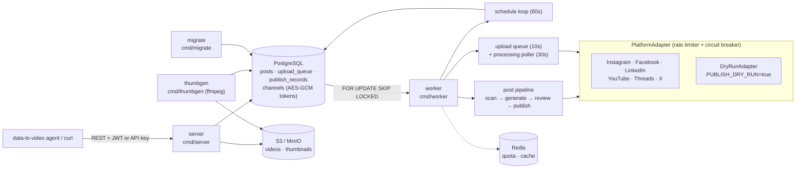

# social-publisher

A Go service that schedules and posts content to Instagram, Facebook, LinkedIn, YouTube, Threads and X.

## Demo

Worker log from a dry-run session with zero credentials (JSON fields trimmed). The first block is the Quickstart below: one post fanned out to five networks. The last two lines are the video path, where a rendered video goes to YouTube via `POST /api/v1/videos/{id}/publish-to-platform`.

```text
{"level":"INFO","msg":"pub worker: publishing","post_id":"72035f0a-daa1-4d48-ad0a-e1043c41202f","platforms":["instagram","facebook","linkedin","threads","twitter"],"retry_count":0}
{"level":"INFO","msg":"would publish linkedin 72035f0a-daa1-4d48-ad0a-e1043c41202f Hello from social-publisher on LinkedIn","dry_run":true}
{"level":"INFO","msg":"would publish instagram 72035f0a-daa1-4d48-ad0a-e1043c41202f Hello from social-publisher on Instagram","dry_run":true}
{"level":"INFO","msg":"would publish facebook 72035f0a-daa1-4d48-ad0a-e1043c41202f Hello from social-publisher on Facebook","dry_run":true}
{"level":"INFO","msg":"would publish threads 72035f0a-daa1-4d48-ad0a-e1043c41202f Hello from social-publisher on Threads","dry_run":true}
{"level":"INFO","msg":"would publish twitter 72035f0a-daa1-4d48-ad0a-e1043c41202f Hello from social-publisher on X","dry_run":true}
{"level":"INFO","msg":"pub worker: publish complete","post_id":"72035f0a-daa1-4d48-ad0a-e1043c41202f","published":5,"failed":0,"retry_count":0}
{"level":"INFO","msg":"would publish youtube 18b45832-469d-4da8-9361-b95005922d4a Demo upload from the data-to-video pipel...","dry_run":true}
{"level":"INFO","msg":"upload processing completed","platform":"youtube"}
```

The post ends up `published` and each platform gets a `post_publish_links` row with a synthetic `https://dry-run.invalid/...` URL. Set `PUBLISH_DRY_RUN=false` and connect real channels to post for real.

## Why it exists

Every social network has its own auth, upload protocol, rate limits and failure modes, and a content pipeline should not have to know any of them. social-publisher is the publishing half of a data-to-video agent pipeline: the sibling `data-to-video` project renders a video, uploads it, and calls this service over HTTP. From there the service handles review, scheduling, retries and the per-platform upload dance.

## Architecture



Four binaries share one module: `server` (HTTP API), `worker` (all background loops), `migrate` (transactional SQL migrations with an advisory lock) and `thumbgen` (backfills video thumbnails with ffmpeg).

## Key ideas

- **One adapter interface, two publish paths.** Text and image posts go through `PostPublisher` (Instagram, Facebook, LinkedIn, Threads, X). Videos go through `UploadOrchestrator` (all six, including YouTube). Every network sits behind a `PlatformAdapter`, so dry-run swaps all of them for one `DryRunAdapter` (`internal/service/publish_adapter.go`).
- **Postgres is the queue.** Workers claim rows with `UPDATE ... WHERE id = (SELECT ... FOR UPDATE SKIP LOCKED)`, and rows stuck in a transient state for more than 5 minutes are reclaimed. You can run as many workers as you like without double-posting.
- **Idempotent retries.** Failed posts are retried up to 3 times. Platforms that already succeeded are recorded in `post_publish_links (UNIQUE post_id, platform)` and skipped on retry, so a partial failure never produces duplicate posts.
- **Back-pressure per platform.** Each network has a token-bucket rate limiter (`golang.org/x/time/rate`) and a circuit breaker that opens after 5 consecutive failures for 5 minutes. A Redis quota tracker charges 1,600 units per YouTube upload against the daily quota.
- **Tokens encrypted at rest.** OAuth access and refresh tokens are sealed with AES-256-GCM (`TOKEN_ENCRYPTION_KEY`) before they reach the `channels` table.
- **Platform-native uploads.** YouTube uses resumable uploads streamed from S3 in 10 MB chunks. Instagram and Threads use Meta's container create, then poll, then publish flow. Posts and uploads both accept a `scheduled_at`.

## Quickstart

Requires Docker with Compose v2. No accounts or API keys needed.

```bash
cp .env.example .env
docker compose up -d --build        # db + redis → migrate (one-shot) → app + worker
until curl -sf localhost:8081/health; do sleep 2; done   # {"status":"ok"} once migrations finish
```

Log in as the dev admin. It is created at startup from `DEV_ADMIN_EMAIL` / `DEV_ADMIN_PASSWORD`, and only when `APP_ENV=development`:

```bash
TOKEN=$(curl -s -X POST localhost:8081/api/v1/auth/login \
  -H 'Content-Type: application/json' \
  -d '{"email":"admin@example.com","password":"changeme-dev-only"}' \
  | sed -E 's/.*"access_token":"([^"]+)".*/\1/')
```

Create a post with ready-made copy for each platform, submit it, then approve it:

```bash
POST_ID=$(curl -s -X POST localhost:8081/api/v1/posts \
  -H "Authorization: Bearer $TOKEN" -H 'Content-Type: application/json' \
  -d '{
    "title": "Hello from social-publisher",
    "target_platforms": ["instagram","facebook","linkedin","threads","twitter"],
    "platform_posts": {
      "instagram": {"text": "Hello from social-publisher on Instagram"},
      "facebook":  {"text": "Hello from social-publisher on Facebook"},
      "linkedin":  {"text": "Hello from social-publisher on LinkedIn"},
      "threads":   {"text": "Hello from social-publisher on Threads"},
      "twitter":   {"text": "Hello from social-publisher on X"}
    }
  }' | sed -E 's/^\{"id":"([^"]+)".*/\1/')

curl -s -X POST localhost:8081/api/v1/posts/$POST_ID/submit         -H "Authorization: Bearer $TOKEN"
curl -s -X POST localhost:8081/api/v1/admin/posts/$POST_ID/approve  -H "Authorization: Bearer $TOKEN"
```

The worker polls every 15 seconds:

```bash
sleep 20
docker compose logs worker | grep "would publish"
curl -s localhost:8081/api/v1/admin/posts/$POST_ID/publish-status -H "Authorization: Bearer $TOKEN"
```

To schedule a post instead, call `PATCH /api/v1/posts/{id}/schedule` with `{"scheduled_at":"<RFC3339>"}`. The schedule loop releases it when it is due. Videos are published with `POST /api/v1/videos/{id}/publish-to-platform` after an upload through `/api/v1/uploads/*`. That path needs S3: run `docker compose --profile storage up -d` to start MinIO, then create the buckets named in `.env`.

Clean up with `docker compose down -v`. To run without Docker, start Postgres and Redis yourself, point `.env` at them, then run `make migrate`, `make dev` and `make worker`.

## Configuration

Every variable is listed with a placeholder in [`.env.example`](.env.example). The main ones:

| Variable | Default | Purpose |
|---|---|---|
| `PUBLISH_DRY_RUN` | `true` | Route every platform adapter to the dry-run mock. Set `false` for real posting. |
| `DEV_ADMIN_EMAIL` / `DEV_ADMIN_PASSWORD` | unset | Dev-only admin bootstrap (needs `APP_ENV=development`). |
| `APP_ENV` | `development` | `production` turns on strict config validation. |
| `APP_PORT`, `APP_HOST`, `APP_BASE_URL` | `8081`, `localhost`, `http://localhost:8081` | HTTP listener and public base URL (used for OAuth callbacks). |
| `API_PORT` | `8081` | Host port published by docker compose. |
| `DB_HOST`, `DB_PORT`, `DB_USER`, `DB_PASSWORD`, `DB_NAME`, `DB_SSLMODE` | `localhost`, `5432`, `socialpub` ×3, `disable` | PostgreSQL connection. |
| `REDIS_ADDR`, `REDIS_PASSWORD`, `REDIS_DB`, `REDIS_TLS` | `localhost:6379`, empty, `1`, `false` | Redis for quota and cache. |
| `JWT_SECRET`, `JWT_ACCESS_TOKEN_TTL`, `JWT_REFRESH_TOKEN_TTL` | dev value, `15m`, `720h` | API authentication. |
| `TOKEN_ENCRYPTION_KEY` | empty (no encryption) | 64 hex chars; AES-256-GCM key for stored OAuth tokens. |
| `S3_*`, `S3_COLD_*` | MinIO on `localhost:9000` | Video, thumbnail and archive storage. |
| `GOOGLE_*`, `FACEBOOK_*`, `INSTAGRAM_*`, `THREADS_*`, `TWITTER_*`, `LINKEDIN_*` | empty | OAuth app credentials (`_CLIENT_ID`, `_CLIENT_SECRET`, `_REDIRECT_URL`) for connecting real channels. |
| `YOUTUBE_DAILY_QUOTA` | `10000` | YouTube Data API units per day. |
| `CLAUDE_API_KEY` | empty | Optional. Generates platform copy for posts created from a `source_url`. |
| `SMTP_*` | empty | Optional. Password-reset email. |

## Results

Only numbers you can check in this repo:

- **6 platforms** on the video path (`SupportedVideoPlatforms`), **5** on the text/image path (`SupportedPostPlatforms`).
- **4 binaries** (`server`, `worker`, `migrate`, `thumbgen`), **39** SQL migrations, **311** `/api/` routes in `internal/router/router.go`.
- **593** Go test functions. `go test ./...` runs without a database; DB-backed tests skip themselves.

## Status, limits and licence

- **Status:** extracted from a private production codebase and cleaned up for public release. It runs end to end in dry-run mode.
- **Real posting** needs your own developer app on each network, connected channels, and usually the platform's app review: Meta for the Instagram, Facebook and Threads publish permissions, LinkedIn product access ("Share on LinkedIn", plus Marketing Developer Platform for organization video posts), and an X developer app with write scopes. Platform quotas apply.
- **Scope:** the codebase grew beyond publishing. It still contains creator, editor and payout modules, A/B tests, newsletters and similar. Several worker loops (clips, dubbing, payouts, newsletters) are stubs that only change status. No web frontend is included; the API is the interface.
- **Quickstart scope:** the Quickstart covers the text/image path only. The video path, including YouTube, needs an uploaded video in S3 and a `channels` row with `connection_status='connected'`, even in dry-run mode. The YouTube line in the Demo came from such a row inserted directly into the database.
- **Scheduling:** only posts in `draft`, `generated` or `approved` can be scheduled. A hand-written post reaches `approved` only after review, and from there the publish loop (every 15 s) usually wins the race unless you schedule it right after approval.
- **AI generation:** posts created from a `source_url` are scraped and their copy is written by Claude, which needs `CLAUDE_API_KEY`. Posts that supply `platform_posts` skip that step.
- **Licence:** [MIT](LICENSE) © 2026 Himanshu Mehta.
